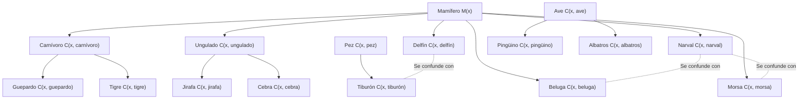
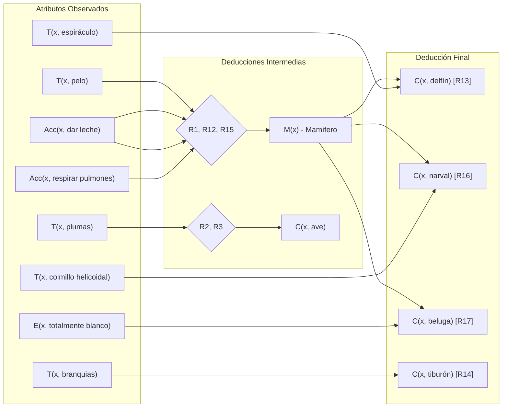

# Ontología de Clasificación Animal y Deducción Lógica

**Materia:** Programación Lógica (7SE)  
**Docente:** María de Lourdes Aguillón Ruiz  
**Institución:** Instituto Tecnológico de Ensenada  

---

## 1. Definición de Predicados

La representación formal del conocimiento se basa en la siguiente sintaxis lógica:

* $M(x)$: $x$ es un mamífero
* $T(x, y)$: $x$ tiene el atributo o rasgo $y$
* $A(x, y)$: $x$ se alimenta de $y$
* $Acc(x, y)$: $x$ realiza la acción $y$
* $E(x, y)$: $x$ posee el patrón o color $y$
* $C(x, y)$: $x$ pertenece a la clase o especie $y$

---

## 2. Grafo de la Ontología Taxonómica

Diagrama en Mermaid de la jerarquía taxonómica y vínculos de confusión entre especies:

---

## 3. Grafo de Deducción Lógica y Reglas

Flujo de reglas ($R_1$ a $R_{18}$) utilizadas para deducir la clase o especie a partir de los atributos observados:

---

## 4. Matriz de Hechos y Diferenciadores Específicos

| Animal | Hechos Base Observados | Deducción por Regla | Especie con la que se Confunde | Rasgo Diferenciador Clave |
| :--- | :--- | :--- | :--- | :--- |
| **Delfín** | Amamanta, respiración pulmonar, espiráculo, aleta caudal horizontal | $M(x)$ (R12), $C(x, \text{delfín})$ (R13) | Tiburón | Espiráculo y aleta horizontal (no vertical) |
| **Tiburón** | Pez, branquias, aleta caudal vertical | $C(x, \text{pez})$, $C(x, \text{tiburón})$ (R14) | Delfín | Branquias y aleta caudal vertical |
| **Narval** | Amamanta, sangre caliente, pulmones, colmillo helicoidal | $M(x)$ (R12), $C(x, \text{narval})$ (R16) | Beluga / Morsa | Gran colmillo largo en forma de espiral |
| **Beluga** | Amamanta, sangre caliente, pulmones, totalmente blanco | $M(x)$ (R12), $C(x, \text{beluga})$ (R17) | Narval | Coloración blanca y ausencia de colmillo |
| **Morsa** | Amamanta, sangre caliente, pulmones, dos colmillos hacia abajo, sale a tierra | $M(x)$ (R12), $C(x, \text{morsa})$ (R18) | Narval | Dos colmillos apuntando hacia abajo y desplazamiento en tierra |
